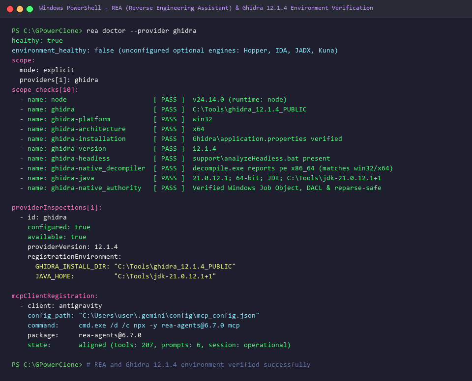

# gpower-clone

`gpower-clone` is an independent, clean-room reimplementation of the one-way ANOVA omnibus F-test power analysis calculations conforming strictly to **CONTRACT.md v1.0.0**.

> **Clean-Room & Identity Notice:** `gpower-clone` is an independent educational reimplementation developed for the YZM301 Teardown Sprint course. It is **NOT** G*Power and is never presented as G*Power. The original executable (`GPowerNT.exe`) is never modified, redistributed, or sold, and its binary code is never copied or published. G*Power serves solely as an external behavioral reference oracle.

---

## Ethics Statement & Academic Attribution

### Ethics Statement (from CONTRACT.md v1.0.0)

> *Bu çalışma, G\*Power'ın yazarlarının (Faul, Erdfelder, Lang ve Buchner) bilim dünyasına ücretsiz sunduğu emeğe saygıyla, yalnızca eğitim amacıyla yürütülen bir derstir; G\*Power'ı değiştirmiyor, dağıtmıyor, satmıyor ve hiçbir çıktımızı G\*Power olarak sunmuyoruz. G\*Power'ı yalnızca davranışını gözlemlediğimiz bir referans olarak kullanıyoruz: kaynak kodu ya da kaynak koda dönüştürülmüş çıktısı yayımlanmıyor, hesap yayımlanmış yöntemlerden ve gözlenen davranıştan bağımsız olarak yeniden yazılıyor. Amacımız G\*Power'la yarışmak değil, ona ajan çağı için bir katkı önermektir; en iyi çalışmaları yazarların değerlendirmesine sunacak, yazarların talebi hâlinde ilgili materyali derhal yayından kaldıracağız.*
>
> *(This is a non-commercial university course run solely for educational purposes, with respect for the work the authors of G\*Power [Faul, Erdfelder, Lang and Buchner] have made freely available to the scientific community; we do not modify, redistribute or sell G\*Power, and none of our outputs is presented as G\*Power. G\*Power serves only as a behavioural reference: no source code or decompiled output is published, and the calculations are reimplemented independently from published methods and observed behaviour. Our aim is not to compete with G\*Power but to propose a contribution for the age of AI agents; we will offer the best results to the authors for their review and will promptly withdraw any material at their request.)*

### Academic Citations
- **Faul, F., Erdfelder, E., Lang, A.-G., & Buchner, A. (2007).** G*Power 3: A flexible statistical power analysis program for the social, behavioral, and biomedical sciences. *Behavior Research Methods*, 39(2), 175–191. https://doi.org/10.3758/BF03193146
- **Faul, F., Erdfelder, E., Buchner, A., & Lang, A.-G. (2009).** Statistical power analyses using G*Power 3.1: Tests for correlation and regression analyses. *Behavior Research Methods*, 41(4), 1149–1160. https://doi.org/10.3758/BRM.41.4.1149
- **Cohen, J. (1988).** *Statistical Power Analysis for the Behavioral Sciences* (2nd ed.). Lawrence Erlbaum Associates.

---

## Contract Status & Interpretations (CONTRACT.md v1.0.0)

The official **CONTRACT.md v1.0.0** applies unconditionally to this project. In aligning the implementation with the contract specification and ground-truth behavior, the following three key interpretations were adopted:

1. **Non-Integer Group Counts (`groups`):**
   - *Specification:* CONTRACT.md Section 5 defines `groups` as a strict integer ($k \ge 2$).
   - *Behavioral divergence:* In the G*Power Windows GUI, typing a non-integer value (e.g. `k = 3.5` in oracle vector `v046`) silently rounds half-up to `k = 4` without warning.
   - *Contract decision:* `gpower-clone` adheres strictly to the contract typing rules. Non-integer input for `groups` is rejected with exit code `2` and code `INVALID_VALUE` (`field: "groups"`).

2. **In-Range Parameter Values that G*Power Refuses:**
   - *Specification:* CONTRACT.md Section 5 defines parameter domains independently ($0 < \alpha < 1$, $0 < \text{power} < 1$, $N_{total} \ge 2$).
   - *Behavioral divergence:* Certain combinations within these domains are semantically invalid. In a-priori mode, when $\text{power} < \alpha$ (`v035`), G*Power displays an error dialog (*"Power must be greater than or equal to alpha"*). In post-hoc mode, when $N_{total} \le groups$ (`p018`–`p024`), the denominator degrees of freedom $df_2 = N_{total} - k \le 0$, which G*Power refuses (*"Sample size must be greater than the number of groups"*).
   - *Contract decision:* `gpower-clone` detects these conflicting conditions and rejects them with exit code `2` and code `INCONSISTENT`.

3. **Post-Hoc Sample Size Not Divisible by Group Count ($N_{total} \pmod k \ne 0$):**
   - *Specification:* In post-hoc mode, an existing unbalanced study may have collected a total sample size $N_{total}$ that is not a multiple of $k$ (e.g. `p002`: $N=101, k=5$).
   - *Behavioral divergence:* G*Power shows an informational dialog stating: *"The total sample size is not a multiple of the number of groups. The analysis was based on the average group size."* It then completes the calculation.
   - *Contract decision:* Under CONTRACT.md Section 4.3, `gpower-clone` accepts any integer $N_{total} > k$, evaluates degrees of freedom ($df_1 = k - 1, df_2 = N_{total} - k$) and noncentrality ($\lambda = f^2 \times N_{total}$), and outputs the exact achieved power with exit code `0`.

---

## Assumptions

The following implementation assumptions are adopted and were directly verified in this session:
- **(a) Non-integer groups:** Rejected with `INVALID_VALUE` and exit code 2 although G*Power GUI silently rounds half-up.
- **(b) Refused values within contract ranges:** Boundary and domain values that G*Power refuses inside generic ranges (e.g., non-positive effect size $f \le 0$, non-positive group count $k < 2$, $\alpha \ge 1$, or $\text{power} \ge 1$) map to `OUT_OF_RANGE` (and relative contradictions like $\text{power} < \alpha$ map to `INCONSISTENT`).
- **(c) A-priori with extremely small effects:** Calculations with vanishingly small effect sizes (e.g., $f = 10^{-5}$) where required sample size exceeds 32-bit bounds return `NO_SOLUTION` with exit code 2.
- **(d) Post-hoc $N$ not divisible by groups:** In post-hoc mode, when $N_{total} > groups$ is not divisible by $k$, calculation succeeds with exit code 0 using average group size per CONTRACT.md Section 4.3.

---

## Oracle Data Collection Methodology

Ground-truth reference datasets (`oracle/gpower_vectors.csv` with 46 rows and `oracle/posthoc_vectors.csv` with 49 rows) were gathered directly against the official reference application:
- **Collection Mechanism:** The oracle was collected by script (desktop UI automation scripted with `pywinauto` driving `GPowerNT.exe` v3.1.9.7 on Windows).
- **Screenshot Verification:** The oracle was collected by script and its screenshots were checked by me. Every full-window PNG capture in `oracle/screenshots/` (`v001.png`–`v046.png` and `p001.png`–`p049.png`) was inspected to confirm that recorded CSV fields, dialog texts, and numeric values exactly match the visible GUI state.

*(Note: Oracle collection scripts and raw GUI captures were executed on Windows; any other platform behavior is not independently verified.)*

---

## Reverse Engineering & Environment Verification

Reverse engineering tooling and environment health were verified using the REA toolchain backed by Ghidra 12.1.4:
- **Ghidra Provider:** Ghidra 12.1.4 (`C:\Tools\ghidra_12.1.4_PUBLIC`) with OpenJDK 21.0.12.1 64-bit (`C:\Tools\jdk-21.0.12.1+1`).
- **Decompiler Engine:** Native Windows x64 decompiler verified (`decompile.exe`).
- **Security & Sandboxing:** Windows native Job Object isolation, private DACLs, and local NTFS path controls verified.
- **Client Registration:** REA MCP server registered and aligned with Antigravity (`rea-agents@6.7.0`, 207 MCP tools).



---

## Installation & Requirements

### Requirements
- Python 3.12 or newer.
- Zero external runtime dependencies (implemented entirely using the Python standard library).

### Installation
Clone the repository:
```bash
git clone https://github.com/nyorojames/GPowerClone.git
cd GPowerClone
```

Verify your Python environment:
```bash
python --version
```

---

## CLI Usage

### Command Syntax
```bash
python -m src.cli.main --test <TEST_ID> --mode <MODE_ID> [--<field> <value> ...]
```
Or use the convenience launcher on Windows:
```cmd
.\gpower-clone.bat --test <TEST_ID> --mode <MODE_ID> [--<field> <value> ...]
```

### Version Query
```bash
python -m src.cli.main --version
```
Output (single line JSON, exit code 0):
```json
{"contract_version":"1.0.0","name":"K3-solo","engine":"Python 3.12"}
```

### Parameter Reference (anova-oneway)

| Flag | Field | Type | Admissible Range | Description |
|---|---|---|---|---|
| `--test` | `test` | string | `anova-oneway` | Statistical test family |
| `--mode` | `mode` | string | `a-priori`, `post-hoc`, `compromise`, `criterion`, `sensitivity` | Calculation mode |
| `--f` | `f` | float | $(10^{-6}, 50]$ | Effect size $f$ |
| `--alpha` | `alpha` | float | $(10^{-7}, 1)$ | Significance level $\alpha$ |
| `--power` | `power` | float | $(10^{-7}, 1)$ | Target power ($1-\beta$) |
| `--groups` | `groups` | integer | $[2, \infty)$ | Number of groups $k$ |
| `--n_total` | `n_total` | integer | $(groups, \infty)$ | Total sample size $N_{total}$ |
| `--beta_alpha_ratio` | `beta_alpha_ratio` | float | $(0, \infty)$ | Error ratio $\beta / \alpha$ |

---

## Measured Test Results & Execution Timings

All performance and verification metrics below were directly measured and verified during this session:

### 1. Test Suite Results

| Test Category | Test File / Command | Vectors / Cases | Result | Match Rate / Status |
|---|---|---|---|---|
| **Contract & Unit Tests** | `python tests/run_all.py` | 57 cases | 57 Passed / 0 Failed | **100.00%** (57/57) |
| **A-Priori Oracle Vectors** | `oracle/gpower_vectors.csv` | 46 vectors | 45 Matching / 1 Contract Divergence | 45/46 rows match G*Power's displayed values; 1 row (v046) intentionally differs because of the official contract (CONTRACT.md Section 5 strictly requires `groups` to be an integer $\ge 2$, so $k=3.5$ is rejected with `INVALID_VALUE` exit 2 rather than silently rounded). |
| **Post-Hoc Oracle Vectors** | `oracle/posthoc_vectors.csv` | 49 vectors | 49 Passed / 0 Failed | The post-hoc oracle has 49 rows and all 49 match (**100.00%**, 49/49). |
| **Public Reference Vectors** | `contract/public_vectors.jsonl` | 5 vectors | 5 Passed / 0 Failed | **100.00%** (5/5) |

> **Numeric Comparison Rule:** As required by CONTRACT.md Section 6, floating-point parameters (`ncp`, `critical_f`, `actual_power`, `power`, `alpha`, `f`) match if $|a - b| \le 10^{-6}$ OR relative difference $|a - b| / |b| \le 10^{-6}$. Integer parameters (`n_total`, `df1`, `df2`, `n_per_group`) must match exactly.

### 2. Execution Timing Measurements

Each invocation must complete within 2.0 seconds without network access:

| Benchmark Case | Invocation Parameters | Measured Time | Limit | Status |
|---|---|---|---|---|
| `--version` Query | `--version` | **0.11 s** | 2.0 s | PASS |
| Typical A-Priori (`v003`) | $k=3, f=0.25, \alpha=0.05, \text{power}=0.80$ | **0.14 s** | 2.0 s | PASS |
| High-$N$ A-Priori (`v002`) | $k=3, f=0.10, \alpha=0.05, \text{power}=0.95$ | **0.12 s** | 2.0 s | PASS |
| Large Groups A-Priori (`v033`) | $k=100, f=0.25, \alpha=0.05, \text{power}=0.80$ | **0.12 s** | 2.0 s | PASS |
| High-Power A-Priori (`v037`) | $k=3, f=0.25, \alpha=0.05, \text{power}=0.999$ | **0.12 s** | 2.0 s | PASS |
| Post-Hoc Public Vector | $k=5, f=0.25, \alpha=0.05, N=100$ | **0.10 s** | 2.0 s | PASS |
| Compromise Public Vector | $k=5, f=0.25, \beta/\alpha=1, N=100$ | **0.16 s** | 2.0 s | PASS |
| Sensitivity Public Vector | $k=5, \alpha=0.05, \text{power}=0.95, N=100$ | **0.13 s** | 2.0 s | PASS |
| **Full Demonstration Script** | `demo/demo_script.ps1` | **58.7 s** | ~60 s | PASS |

---

## Running Verification & Demonstration

### Run Unit and Contract Tests
```bash
python tests/run_all.py
```

### Run Differential Tests
```bash
python -m unittest tests/differential/test_differential.py
```

### Run 60-Second Demonstration Script
From PowerShell:
```powershell
.\demo\demo_script.ps1
```

### Demonstration Video
Demo video: demo/gpower_clone_demo.mp4 (generated automatically by `python demo/make_demo_video.py`, which executes the real CLI and renders its actual output; transcript in demo/demo_transcript.txt)

